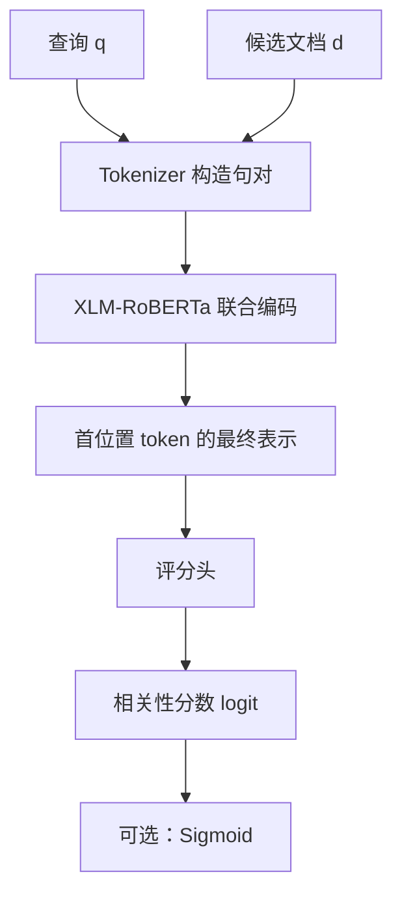
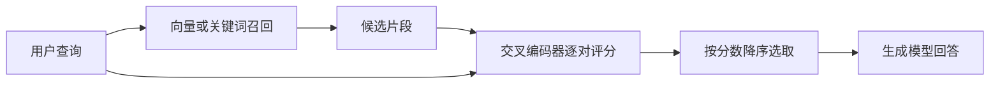

> ([[chapter3-用户记忆和知识库.pdf#page=16&selection=31,19,32,6&color=yellow|chapter3-用户记忆和知识库, p.15]])
> 倒数排名融合

**如果同一篇文档在稀疏检索和稠密检索中排名相同，两路贡献照常相加。** RRF 只看排名，不使用原始的 BM25 分数或向量相似度。

标准等权 RRF 的公式是：

$$
\mathrm{RRF}(d)
=
\frac{1}{k+r_{\text{稀疏}}(d)}
+
\frac{1}{k+r_{\text{稠密}}(d)}
$$

其中排名从 **1** 开始，$k$ 是平滑常数。[公式来源：Elasticsearch 官方文档](https://www.elastic.co/docs/reference/elasticsearch/rest-apis/reciprocal-rank-fusion)

如果文档在两路都排第 $r$，就得到：

$$
\boxed{\mathrm{RRF}(d)=\frac{2}{k+r}}
$$

例如取 $k=60$：

| 文档 | 稀疏排名 | 稠密排名 | RRF 分数 |
| --- | --- | --- | --- |
| A | 1 | 1 | $2/61\approx0.03279$ |
| B | 2 | 2 | $2/62\approx0.03226$ |
| C | 3 | 3 | $2/63\approx0.03175$ |

所以，**如果两路的文档及顺序完全一致，融合后顺序不变，分数是单路贡献的两倍。** 同一篇文档最终只保留一条结果，累加两路分数。

注意，“排名相同”必须对应同一篇文档：稀疏检索第一名是 A、稠密检索第一名是 B，不能把它们的分数加在一起。

以上按标准等权 RRF 计算，带权重或归一化的实现数值会不同。

---
> ([[chapter3-用户记忆和知识库.pdf#page=16&selection=93,0,94,23&color=yellow|chapter3-用户记忆和知识库, p.15]])
>  BAAI/bge-reranker-v2-m3
---
aliases:
  - BGE 重排序模型
  - bge-reranker-v2-m3
tags:
  - NLP
  - RAG
  - CrossEncoder
  - Reranker
---

# BAAI/bge-reranker-v2-m3 的工作原理

> [!abstract] 核心思想
> 把**查询和候选文档一起输入 Transformer**，让两者的 token 充分交互，再输出一个相关性分数，用于重新排列候选文档。

## 📌 1. 模型的定位

`BAAI/bge-reranker-v2-m3` 是支持多语言的交叉编码器，以 `bge-m3` 为基础构建，用于判断查询与文档的相关程度。

它的计算可以写成：

$$
s(q,d)=f_\theta(q,d)
$$

其中：

- $q$：查询。
- $d$：候选文档或文本片段。
- $\theta$：模型参数。
- $s(q,d)$：相关性分数，越大表示模型判断越相关。

它的主要输出是**句对的分数**，用于重排序。

## 🔄 2. 与双编码器的区别

双编码器先分别编码，再比较向量：

$$
\mathbf{u}=E(q),\qquad \mathbf{v}=E(d)
$$

$$
s_{\text{bi}}(q,d)=
\frac{\mathbf{u}^{\mathsf T}\mathbf{v}}
{\|\mathbf{u}\|\|\mathbf{v}\|}
$$

交叉编码器则联合处理句对：

$$
s_{\text{cross}}(q,d)=f_\theta([q;d])
$$

这里的 $[q;d]$ 表示将两段文本组合成同一条输入序列。

| 比较项 | 双编码器 | 交叉编码器 |
|---|---|---|
| 输入方式 | 查询与文档分别编码 | 查询与文档联合编码 |
| 文本之间的交互 | 编码后比较向量 | 编码过程中进行 token 级交互 |
| 文档表示能否提前缓存 | 可以 | 联合表示依赖当前查询 |
| 典型用途 | 大规模召回 | 候选结果精排 |

交叉编码器保留了更细致的匹配信息，但需要为每个查询—文档组合执行联合编码，因此通常用于有限数量的候选结果。

## ⚙️ 3. 一次评分的内部过程



### 3.1 将查询和文档组成一条序列

XLM-RoBERTa 的句对格式为：

```text
<s> 查询 token </s></s> 文档 token </s>
```

其中 `<s>` 位于序列开头，`</s>` 用于分隔和结束序列。模型使用子词 token，token 不一定对应完整的汉字或单词。

### 3.2 通过自注意力实现跨文本交互

模型配置为 24 层 Transformer，隐藏维度为 1024，每层包含 16 个注意力头。

对于某一层、某一个注意力头，简化计算为：

$$
Q=HW_Q,\qquad K=HW_K,\qquad V=HW_V
$$

$$
\operatorname{Attention}(Q,K,V)
=
\operatorname{softmax}
\left(
\frac{QK^{\mathsf T}}{\sqrt{d_k}}+M
\right)V
$$

这里 $H$ 包含查询和文档的 token 表示，$M$ 是注意力掩码。

因为两段文本位于同一序列中，查询 token 可以关注文档 token，文档 token 也可以关注查询 token。多层处理后，每个位置的表示都能够融合两段文本的信息。

> [!important] “交叉编码”与“交叉注意力”
> 这里的跨文本交互通过拼接序列上的**双向自注意力**实现。它不要求额外设置编码器—解码器式的 Cross-Attention 模块。

例如，查询“哪些药不能与酒同服”中的“不能”，可以与文档中的药品名称、饮酒条件和禁忌描述共同参与匹配。这个例子用于说明机制，不代表模型必然正确处理所有否定关系。

### 3.3 从联合表示得到分数

标准 XLM-RoBERTa 序列分类头读取首位置 `<s>` 的最终隐藏状态：

$$
\mathbf{h}_0=H_{\text{final}}[0]
$$

推理时省略关闭的 Dropout，可以写成：

$$
z=
W_2\tanh(W_1\mathbf{h}_0+\mathbf{b}_1)+b_2
$$

模型对每个句对输出一个标量 $z$，即原始 logit。这里的 $\mathbf{h}_0$ 已融合查询与文档的信息，因此会随着查询改变。

## 📊 4. 分数应该怎样理解

官方推理示例直接读取 `model(...).logits`。原始分数可以为负数，也可以大于 1；分数越高，表示模型判断越相关。

可以通过 Sigmoid 将分数映射到 $(0,1)$：

$$
r=\sigma(z)=\frac{1}{1+e^{-z}}
$$

以下只是数学演示：

| 原始分数 $z$ | Sigmoid 后的 $r$ |
|---:|---:|
| -2 | 0.119 |
| 0 | 0.500 |
| 2 | 0.881 |

由公式可知：

- Sigmoid 单调递增，因此不会改变排序。
- 每个句对单独变换，所有候选分数不需要加起来等于 1。
- 映射到 $(0,1)$ 只是数值变换，不能据此把 `0.9` 解释为“答案有 90% 的概率正确”。

## 🔍 5. 在 RAG 中如何工作

常见流程是先召回，再重排序，最后把选中的文本交给生成模型。



对于候选集合：

$$
D=\{d_1,d_2,\ldots,d_N\}
$$

分别计算：

$$
s_i=f_\theta(q,d_i)
$$

然后按照 $s_i$ 降序排列。

从这个计算过程可知，模型默认对每个句对独立评分；将多个句对放入同一批次，是为了提高计算效率，并不意味着候选文档彼此进行注意力交互。

## 📏 6. 输入长度与能力边界

该模型的 Tokenizer 配置将最大输入长度设为 **8192 token**。查询、文档和特殊 token 共同占用长度预算；实际推理还会受到调用时 `max_length` 等参数的限制。

因此需要留意：

- **截断**：关键内容被截掉后，评分只能基于剩余文本。
- **计算成本**：标准全注意力的注意力矩阵规模随序列长度平方增长。
- **召回范围**：只对已有候选评分，就无法补回未进入候选集的文档。
- **事实正确性**：相关性分数用于匹配排序，不能单独证明文档内容真实。

最后两点是由重排序任务的输入和输出范围得到的工程结论。
